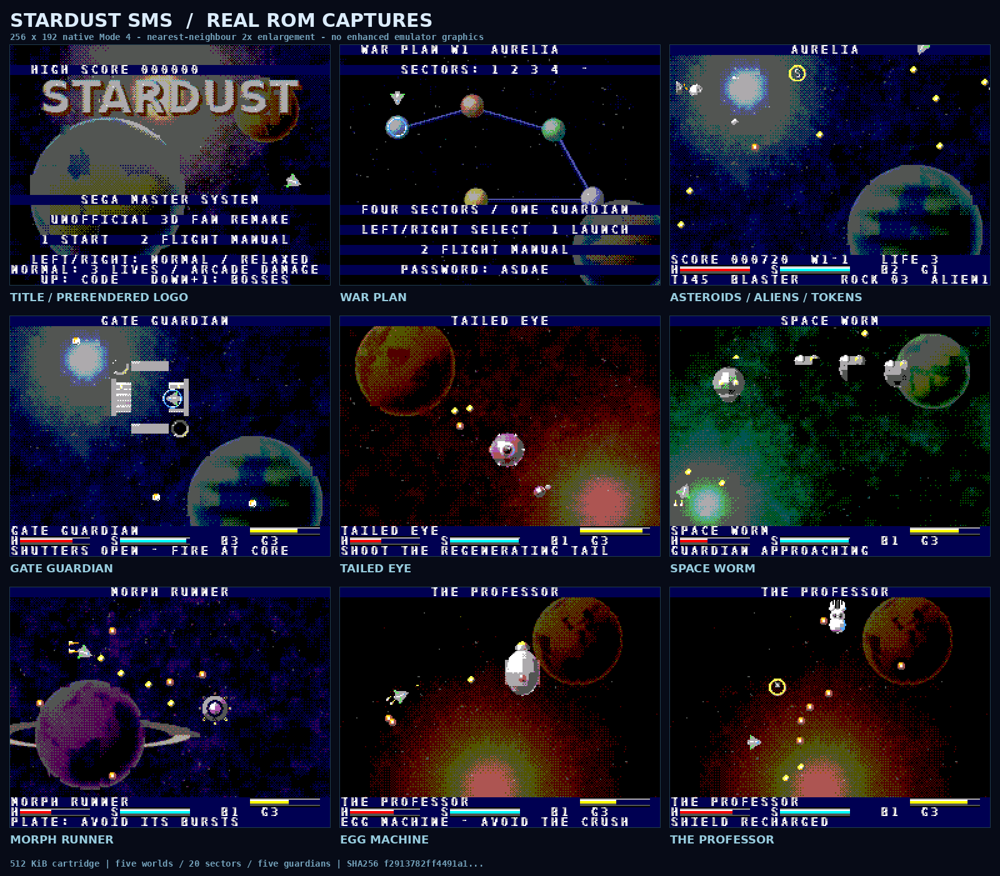

# Stardust SMS

**A playable, independent StarDust-inspired fan remake for the Sega Master System.**

A native **Z80 / Mode-4 VDP** game with prerendered 3D artwork, asteroid combat, enemies, power-ups, five guardians and the **Amiga StarDust soundtrack converted to the Master System PSG**.

| Release detail | Value |
|---|---|
| Validated build | 2026-10-12 |
| Platform | Sega Master System, NTSC and PAL |
| Cartridge | `Stardust_SMS.sms` — 512 KiB (524,288 bytes), standard Sega mapper |
| Tested emulators | Genesis Plus GX and Gearsystem |
| Validation | 139 automated assertions; controller-only campaign and guardian completion |

**Quick links:** [Play](#play-now) · [Controls](#controls) · [Music](#music) · [Artwork](#prerendered-3d-artwork) · [Build](#build-from-source) · [QA](#release-validation) · [License](#credits-and-license)



*Screenshots are captures of the delivered ROM, enlarged with nearest-neighbour scaling—not enhanced emulator graphics or high-resolution mock-ups.*

## Play now

1. Load `Stardust_SMS.sms` in a Sega Master System emulator. Genesis Plus GX and Gearsystem have been tested.
2. Use a normal two-button Master System controller, or map your emulator's controls to it.
3. Press **Button 1** at the title, then **Button 1** on the war-plan map to launch the first sector.
4. Clear all four sector nodes, select **G**, and defeat the world's guardian.

Select **Normal / Relaxed** with Left or Right on the title. Relaxed gives five starting lives, reduced damage and gradual energy recovery; Normal gives three lives and arcade damage. Start with Relaxed if you are learning the inertial controls.

## Controls

| Input | Action |
|---|---|
| Up | Thrust |
| Left / Right | Rotate |
| Down | Activate shields while charge remains |
| Button 1 | Fire; hold for continuous fire |
| Button 2 | Detonate a bomb charge |
| Down + Button 2 | Cycle Blaster → Bouncer → Missile → Flamer |
| Console Pause | Pause / resume; usually mapped to Start by emulators |

**War plan:** Left / Right selects a sector or guardian; 1 launches; 2 opens the manual. Already-cleared sectors are marked with stars.

**Title:** 1 starts, 2 opens the manual, Up enters a campaign code. Hold Down, choose a guardian with Left / Right, and press 1 for guardian practice. Practice starts with a powered gun, missiles and five lives, and chains through the remaining guardians.

**Tunnel:** the D-pad moves the ship directly; 1 fires and 2 bombs. Avoid mines and incoming debris.

**Bonus mission:** gravity pulls down; thrust consumes fuel. Collect X tokens, use F to refuel, then reach the upper-right teleporter and press 1 to leave.

**Manual:** Down toggles music; 1 or 2 returns.

## Included gameplay

- Inertial, rotating ship with wraparound asteroid combat.
- **Five worlds, 20 asteroid sectors and five distinct guardians.**
- Grey, blue, purple and gold meteor armour; large rocks split into smaller pieces.
- Multiple enemy behaviours: chasers, blades, bombers, thorn balls, plates, speeders and fighters; overtime alien reinforcements.
- Gun upgrades, cycling collectible tokens, shields, bombs and extra lives.
- Four weapons: spread blaster, bouncing shots, homing missiles and short-range flamer.
- Four inter-world warp tunnels and two fuel/gravity bonus missions.
- World map, in-ROM manual, campaign codes, normal/relaxed difficulty, pause, guardian practice, game-over and ending.
- The Amiga StarDust music, converted to the PSG: title theme, one tune per world, guardian themes and hyperspace-tunnel tunes. Original PSG sound effects.

### Guardians

1. **Gate Guardian:** shutters protect the core; attack while open.
2. **Tailed Eye:** destroy the regenerating appendages before attacking the eye.
3. **Space Worm:** attack from behind and hit its tail.
4. **Morph Runner:** changes between blades, plate and ball, with different attacks.
5. **The Professor:** defeat the egg machine, then use **shielded collisions at the screen edges** against the weapon-immune professor.

World-five Orbit Platers ignore normal gunfire: do not waste time chasing them. Keep moving and use shields or bombs when necessary.

### Power-up tokens

| Symbol | Effect |
|---|---|
| G | Gun power; three upgrades available |
| Heart / H | Restore energy |
| S | Restore shields |
| * | One bomb charge |
| B | Two bomb charges |
| P | Bonus points |
| E | More responsive steering and thrust |
| X | Extra life, up to nine |
| F | Bonus-mission fuel |

Token contents cycle and eventually disappear. Every sector starts with a visible gun token.

## Campaign codes

The war-plan screen displays a five-symbol code. Write it down, then select **Up** on the title to enter it. Up / Down changes a symbol, Left / Right moves between symbols, 1 accepts and 2 cancels. Invalid codes are rejected.

Codes preserve the world, cleared-sector mask, lives, gun level, selected weapon, difficulty and **up to three bomb charges**. Loading restores energy and shields. Score and the E steering upgrade are not saved. There is no battery-backed save RAM.

## Music

The soundtrack comes from the original Amiga game's music modules (The Player 4.x format, from `Stardust.lha`), converted to the SN76489 PSG:

| Where | Amiga module |
|---|---|
| Title screen | `engage the scy!!!xx` |
| World 1 – Aurelia sectors | `sd-ingame1` |
| World 2 – Crimson Rift sectors | `level2ingame` |
| World 3 – Emerald Void sectors | `level3ingame` |
| World 4 – Morph Nebula sectors | `sd-ingametry2` |
| World 5 – Iron Citadel sectors | `level5ingame` |
| Guardians 1, 2 and 4 | `sd-boss to try2` |
| Guardian 3 – Space Worm | `level3boss` |
| Guardian 5 – egg machine | `level5boss` |
| Guardian 5 – the Professor | `sd-hardcore.finboss` |
| Tunnels 1 and 3 | `sd-umpitunneli hc` |
| Tunnels 2 and 4 | `tunnel4` |

War plan, bonus missions, game-over and the ending keep the original SMS menu tune; sector-clear, manual and code screens keep whatever is playing. Every module loops where the Amiga module loops (some, such as world 3 and the Professor, loop only their closing section).

Not used yet: `hi_score`, `stardust` and `sd-trigger of death` (The Player 4.x) and the five `p6x.*` modules (The Player 5/6). libxmp reads all of them (only the 4.x modules have been through the converter), so they could fill the menu screens; there are 8 free banks (24–31) in the 512 KiB cartridge.

**How it is converted** (`tools/convert_music.py`): libxmp replays each module tick by tick; every 50 Hz tick becomes PSG register state. Each Amiga sample is analysed once for pitch (YIN), drum-versus-tone and an RMS envelope, so plucks and drums decay naturally and arpeggios, vibrato and slides survive. Up to three tonal voices go to the square channels (quietest dropped), kicks become falling pitch sweeps on a free square channel and other drums use the noise channel. Bass is transposed by whole octaves into the PSG's range (lowest note about 109 Hz). The streams are delta-encoded and compressed by repeating earlier frames: 13 tracks, about 13 minutes of music, fit in four 16 KiB banks (20–23).

**How it plays** (`src/music.s`): a line interrupt at raster line 100 runs a small assembly player once per frame (about 380 cycles), so the tempo stays at 50 frames/s however slow a logic frame is, and the VBlank transfers are never delayed. NTSC consoles skip every sixth interrupt; the region is detected at boot. Sound effects borrow square channel 2 (and the noise channel for explosions and hits) and hand them back when they finish. The manual's music toggle and console pause work as before.

To regenerate the music after changing the converter (needs `gcc`, `libxmp-dev` and NumPy):

```sh
make music AMIGA=/path/to/Stardust          # convert, then rebuild the ROM
# or, with WAV previews of the PSG renders:
python3 tools/convert_music.py /path/to/Stardust --preview build/music_preview && make
```

`/path/to/Stardust` is the folder from `Stardust.lha` with the `p4x.*` files. The converted banks are committed, so a normal `make` needs neither the Amiga files nor libxmp. Loudness for gameplay tracks is set by `GAMEPLAY` in the script (peak attenuation 3 for music, 5 for drums), leaving room for sound effects.

## Prerendered 3D artwork

Ships, meteors, enemies, mines, pickups, effects and guardian parts are authored as procedural 3D meshes or displaced spheres, lit and rendered offline. Space scenes use volumetric nebulae, shaded planets and other rendered structures; lettering and panels use embossed lighting. All artwork is converted into **real Master System 4-bit planar patterns and hardware palettes**.

The source includes the mesh definitions, renderer, cached renders and baked cartridge banks. No original Amiga graphics were copied; the music is converted from the original modules (see [Music](#music)).

This is an adaptation, **not a byte-exact port**: each world has four sectors and a guardian, controls are mapped to the two-button SMS pad, the art and engine are independently implemented for the console's limits, and the Amiga music is rearranged for four PSG channels.

## Hardware and performance

- Z80, 256 × 192 Mode 4; 256 × 168 combat area plus HUD.
- 16 KiB VRAM and 8 KiB system RAM; two fixed code pages, bank-switched art and music.
- Up to 32 on-screen colours; 128 sprite patterns and 320 background patterns.
- SAT at `$3F00`, name table at `$3800`; sprite-generator and SAT masks configured for both SMS1 and SMS2 VDPs.
- 8 × 16 hardware sprites; 63-entry compositor, respecting the real eight-sprites-per-scanline limit.
- Target **30 logic updates/sec NTSC**, **25 PAL**. Heavy scenes adapt to a slower cadence; this is not a guarantee of a locked frame rate.
- Gameplay pattern/SAT uploads begin in a guarded VBlank window. Overlapping sprites can still flicker because of the physical scanline limit.

Tested in emulation, **not yet tested on a physical console/flash cartridge**. Prefer NTSC for the intended faster pace; PAL is also tested.

## Build from source

Unzip `Stardust_SMS_Source.zip` and work inside its `Stardust_SMS/` directory. The archive includes the engine, renderer, baked graphics, render caches, fonts, licenses and QA evidence. No original Amiga files or additional image/font downloads are needed to build: the converted music banks are included.

### Compile with the included graphics

A ROM-only build needs **Python 3, Make and SDCC**. SDCC 4.5.0 is the verified compiler; the build script requires SDCC 4.2 or later.

```sh
# Debian / Ubuntu
sudo apt install sdcc make python3

# From the extracted Stardust_SMS/ directory
make
```

The result is `Stardust_SMS.sms`. Build metadata and linker symbols are written under `tests/`; temporary compiler products are under `build/`. Use SDCC **4.5.0** and the included baked banks to reproduce the validated release byte-for-byte.

### Set up the artwork / QA tools

NumPy and Pillow are needed only for artwork generation and automated QA, not for compiling the included baked graphics. Use a virtual environment rather than installing into the system Python:

```sh
sudo apt install gcc g++ git python3-venv
python3 -m venv .venv
. .venv/bin/activate
python -m pip install -r requirements.txt
```

Optional artwork rebuilds, with that environment activated:

```sh
make art                   # rebake the included render caches into SMS tiles
make render                # regenerate all 3D renders and rebuild the cartridge
```

The renderer uses Python/NumPy/Pillow, not Blender. Bundled DejaVu fonts make the art pipeline portable. Set `OPENBLAS_NUM_THREADS=1` for reproducible, efficient single-threaded asset export; the Makefile already does this for artwork targets.

### Reproduce QA

With the artwork / QA environment above activated:

```sh
bash tools/build_tools.sh  # downloads/builds the pinned independent emulator cores
make test                 # rebuilds ROM, runs headless controller tests
```

The test cores require their upstream downloads; they are not bundled in the source archive. Source compilation and artwork rebuilding use the included project files.

Alternatively set `GENPLUSGX_CORE` and `GEARSYSTEM_CORE` to your own libretro `.so` paths. The Linux test frontend uses `dlopen`. Cartridge compilation does not require either emulator.

The campaign and guardian pilots send **controller input only**. Individual pickup, decoder, death and overflow tests use explicit emulator-side RAM fixtures to isolate those cases; there are no test/cheat hooks in the cartridge. See `docs/QA.md` and `tests/QA_report.json`.

## Release validation

The included release report records **139 passing automated assertions**:

- The soundtrack follows the game state in every sampled second of both completion runs, all 13 tracks are heard in the campaign, and NTSC/PAL tempo detection is checked.
- A full **Normal** campaign reached the ending in Genesis Plus GX using controller input only: all 20 sectors, five guardians, four tunnels and both bonus missions. The pilot retries after game-over; this was not a deathless run.
- All five guardians, including the weapon-immune professor, were also defeated through controller-only guardian practice in **both** emulator cores.
- PAL boot and gameplay, pause/resume, all nine token outcomes, weapon selection, campaign-code validation, death/game-over, boosted projectile direction and transition respawns are covered.
- ROM/header checksums, bank contents, colour/tile budgets, SMS1/SMS2 VDP address masks and sampled VBlank transfer timing are checked.
- A fresh extraction of the source archive rebuilt the **exact same ROM** with SDCC 4.5.0.

Physical-console testing has **not** been performed. Full coverage, limitations, emulator revisions and fixture distinctions are documented in [docs/QA.md](docs/QA.md) and [tests/QA_report.json](tests/QA_report.json).

### Verify the cartridge

```sh
sha256sum -c Stardust_SMS.sha256
```

Release SHA-256:

```text
bd5226d5cd84059659917781d853cdbd9af527dac9d519470f3a97dfac33c533
```

Sega header checksum: **`$D7EE`**.

## Project layout

- `src/` — Z80 startup/interrupts, VDP routines, input, PSG sound effects, music player (`music.s`) and game engine.
- `tools/scene3d.py`, `models.py`, `render_assets.py` — procedural 3D art.
- `tools/export_sms.py` — palette, planar tile and resource-bank exporter.
- `tools/build_rom.py` — SDCC build, Sega header/checksum and cartridge packer.
- `tools/convert_music.py`, `tools/music/` — Amiga module to PSG stream converter.
- `tools/smsrun.c`, `test_rom.py` — libretro test frontend and automated QA.
- `assets/sms/` — baked, validated 16 KiB banks, scene manifests and the converted music banks (`music.bin`, `music.json`).
- `assets/cache/`, `assets/fonts/` — render caches and licensed fonts.
- `docs/` — QA, credits and actual ROM screenshots.
- `tests/` — release metadata, automated QA, linker symbols and compact completion traces.
- `Stardust_SMS.sha256` — checksum for the included playable ROM.

The source ZIP excludes compiler intermediates, virtual environments, emulator binaries and bulky development RAM/video/audio dumps. The baked graphics and render caches needed for all build targets are included.

## Changelog

**Amiga soundtrack release (2026-10-12)**

- The title, sectors, guardians and tunnels now play the original StarDust Amiga music instead of the independently composed melody: title, five world themes, four guardian themes (the final guardian switches tune between the egg machine and the Professor) and two alternating tunnel themes. The original SMS tune remains on the menu screens.
- New assembly music player (`src/music.s`) driven by a mid-screen line interrupt with NTSC/PAL tempo correction; music banks 20–23.
- Sound effects now borrow and return PSG channels instead of permanently owning channel 2 and the noise channel.
- New converter `tools/convert_music.py` + `tools/music/`; `make music` target.
- QA: 9 new music assertions (139 total); full campaign and guardian practice re-run on both emulator cores. New SHA-256 and Sega checksum below.

## Credits and license

Inspired by **StarDust, Bloodhouse, 1993**. Reference manual/hints:

- https://www.lemonamiga.com/doc/stardust/1535
- https://www.lemonamiga.com/doc/stardust/1534

This is an unofficial fan tribute, not an endorsed or commercial Amiga-to-SMS port. The music is converted from the original StarDust modules; it is **not** covered by the MIT license and its rights remain with its owners. Original code and generated artwork are provided under the MIT license; bundled fonts and the libretro header retain their own notices. Names and rights in the original game remain with their respective owners. See `LICENSE` and `docs/CREDITS.md`.
